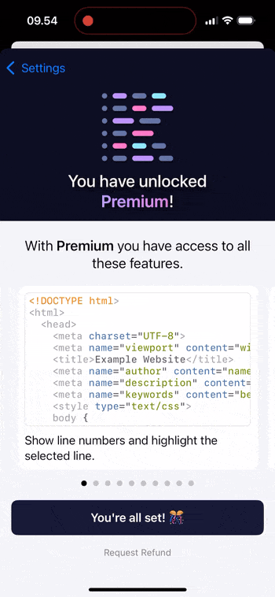
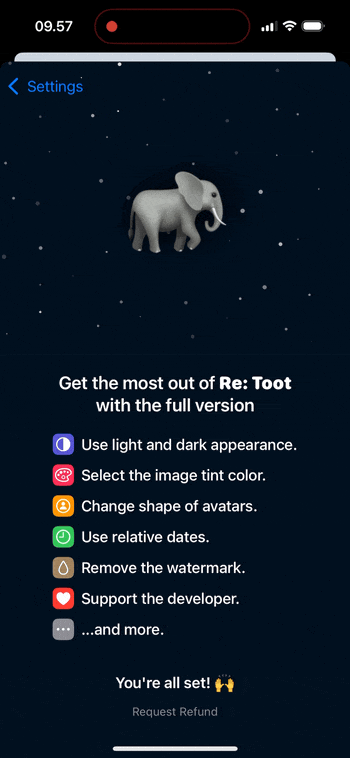

# 🎊 ConfettiKit

A Swift package for shooting confetti. The implementation is heavily inspired by the blog post [Recreating iMessage Confetti](https://bryce.co/recreating-imessage-confetti/) by [Bryce Bostwick](https://mastodon.bryce.co/@bryce).

## 📦 Adding the Package

ConfettiKit is distributed using [Swift Package Manager](https://www.swift.org/documentation/package-manager/). Install ConfettiKit in a project by adding it as a dependency in your Package.swift manifest or through “Package Dependencies” in project settings.

```swift
let package = Package(
    dependencies: [
        .package(url: "git@github.com:simonbs/ConfettiKit.git", from: "1.0.0")
    ]
)
```

## 🚀 Getting Started

ConfettiKit supports iOS 15+, Mac Catalyst 15+, and native macOS 12+. Create a `ConfettiView` with an array of `UIImage` values on UIKit or `NSImage` values on AppKit. Make sure to add the view to your view hierarchy.

```swift
final class ViewController: UIViewController {
    private let confettiView: ConfettiView = {
        let images: [UIImage] = [...]
        let this = ConfettiView(images: images)
        this.translatesAutoresizingMaskIntoConstraints = false
        return this
    }()

    override func viewDidLoad() {
        super.viewDidLoad()
        view.addSubview(confettiView)
        NSLayoutConstraint.activate([
            confettiView.leadingAnchor.constraint(equalTo: view.leadingAnchor),
            confettiView.trailingAnchor.constraint(equalTo: view.trailingAnchor),
            confettiView.topAnchor.constraint(equalTo: view.topAnchor),
            confettiView.bottomAnchor.constraint(equalTo: view.bottomAnchor)
        ])
    }
}
```

When you want to shoot confetti, for example in response to a user interaction, call the `shoot()` function on the confetti view.

```swift
confettiView.shoot()
```

By default, ConfettiView shoots confetti from the top to the bottom, creating the effect shown below.



You may configure it to shoot confetti from the center to the left of the screen.

```swift
let images: [UIImage] = [...]
let confettiView = ConfettiView(mode: .centerToLeft, images: images)
```

This can be used to create the effect shown below.



## Native macOS

On AppKit, `ConfettiView` is an `NSView` with the same initializer, `shoot()` method,
`ConfettiMode` cases, and `birthRate1`/`birthRate2` controls as the UIKit view:

```swift
import AppKit
import ConfettiKit

let images: [NSImage] = [...] // Supply the same artwork as your iOS app.
let confettiView = ConfettiView(images: images)
confettiView.frame = contentView.bounds
confettiView.autoresizingMask = [.width, .height]
contentView.addSubview(confettiView)
confettiView.shoot()
```

The AppKit view uses flipped coordinates so the shared emitter positions, directions,
gravity, foreground/background layers, and animation curves behave like UIKit.
Both platforms use the same Core Animation engine; only view lifecycle and image
conversion differ. Each burst is removed after five seconds, and active bursts
follow view resizing. When embedding confetti as an overlay, the host should arrange
mouse/touch passthrough and respect its platform's Reduce Motion preference.

## 👨‍💻 Contributing

ConfettiKit was specifically built to be used in my side projects, including [Runestone Text Editor](https://apps.apple.com/us/app/runestone-editor/id1548193893) and [Re: Toot](https://apps.apple.com/us/app/re-toot/id1661697436), so its API might be limited. However, pull requests with bug fixes and new features are much appreciated. I'll be happy to review and merge them once they're ready, as long as they align with the vision of ConfettiKit and offer generally useful functionality.

Clone the repository to get started working on the project.

```bash
git clone git@github.com:simonbs/ConfettiKit.git
```
